# AduAI

AduAI adalah sistem pengaduan masyarakat yang membantu pemerintah desa menerima dan menindaklanjuti laporan warga. Warga dapat bercerita kepada asisten AI, memeriksa laporan sebelum dikirim, dan memantau perkembangannya menggunakan nomor tiket. Admin mengelola status, menyertakan bukti, dan memberi kabar melalui WhatsApp.

**[Buka aplikasi AduAI](https://aduai-cmd.vercel.app/)** · [PRD](docs/PRD-AduAI-NextJS.md) · [Dokumentasi AI](docs/ai/README.md) · [Setup WhatsApp](docs/setup-whatsapp.md)

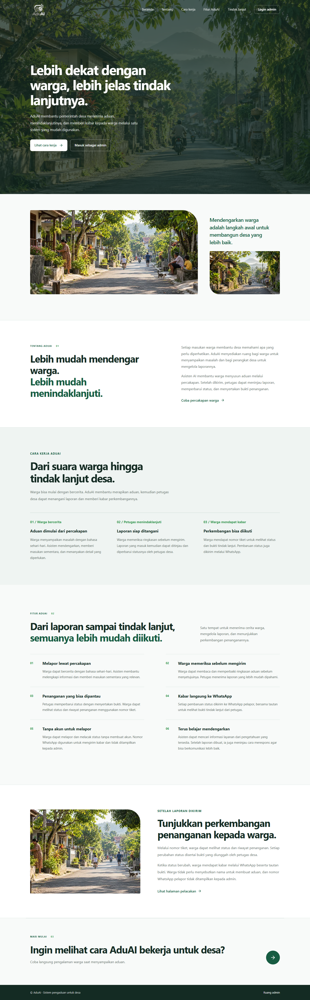

## Fitur

- **Pengaduan lewat percakapan:** AI menanggapi keluhan dengan empati, memberikan saran sementara, dan meminta informasi tambahan yang relevan.
- **Konfirmasi laporan:** warga memeriksa isi laporan sebelum mengirim dan menerima nomor tiket setelah laporan berhasil dibuat.
- **Pelacakan laporan:** warga melihat status dan riwayat penanganan menggunakan nomor tiket.
- **Pengelolaan aduan:** admin meninjau laporan dan memperbarui status dengan menyertakan satu bukti. Nomor WhatsApp pengadu tidak ditampilkan pada respons atau halaman admin.
- **Pembaruan WhatsApp:** Fonnte mengirimkan pemberitahuan saat laporan dibuat dan ketika status diperbarui. Status `QUEUED` berarti permintaan masuk antrean Fonnte, bukan konfirmasi pesan telah diterima.
- **Pengetahuan AI:** admin mengatur provider, Main Knowledge, dan informasi yang dapat dicari AI menggunakan vector search.
- **Perkembangan AI:** sistem mengevaluasi cara AI merespons setelah laporan dibuat dan menyimpan panduan komunikasi yang dapat dipakai pada percakapan berikutnya. Admin dapat memantau perkembangannya.

## Alur penggunaan

1. Warga membuka percakapan dan menceritakan masalahnya kepada AduAI.
2. AI menanggapi, meminta detail yang diperlukan, dan menyusun ringkasan untuk diperiksa.
3. Warga menyetujui pengiriman dan menyimpan nomor tiket yang diberikan.
4. Admin meninjau laporan, mengubah status, dan mengunggah bukti penanganan.
5. Warga menerima pembaruan melalui WhatsApp dan dapat melacak laporan dengan nomor tiket.

Riwayat chat disimpan di browser, sedangkan laporan dan data operasional disimpan di Supabase. Laporan memiliki status **Baru**, **Diterima**, **Sedang ditangani**, **Selesai**, atau **Ditolak**. Perubahan status oleh admin memerlukan bukti; penolakan juga memerlukan alasan.

## Teknologi

| Bagian | Teknologi |
| --- | --- |
| Aplikasi dan API | Next.js App Router, React, TypeScript, Tailwind CSS |
| AI percakapan | Provider API yang kompatibel dengan OpenAI, tool calling, dan streaming SSE |
| Database dan autentikasi | Supabase PostgreSQL, pgvector, dan Supabase Auth |
| Berkas bukti | Supabase Storage, bucket privat `evidence` |
| Pencarian pengetahuan | Transformers.js, embedding 384 dimensi, dan pgvector |
| Notifikasi | Fonnte WhatsApp API |
| Deployment | Vercel |

## Menjalankan secara lokal

### Prasyarat

- Node.js **20.9 atau lebih baru** dan npm.
- Proyek Supabase dengan database, Auth, dan Storage yang telah disiapkan.
- Akun admin di Supabase Auth.
- API key dan model dari provider AI yang mendukung format OpenAI dan tool calling.
- Perangkat Fonnte yang terhubung untuk mencoba notifikasi WhatsApp.

### Instalasi

```bash
npm ci
```

Salin file konfigurasi contoh:

```bash
# macOS / Linux
cp .env.example .env.local
```

```powershell
# Windows PowerShell
Copy-Item .env.example .env.local
```

Isi konfigurasi di `.env.local`:

| Variabel | Kegunaan |
| --- | --- |
| `SUPABASE_URL` | URL proyek Supabase. |
| `SUPABASE_SERVICE_ROLE_KEY` | Service role key Supabase untuk operasi server. |
| `AI_PROVIDER_ENDPOINT` | Endpoint provider AI; digunakan sebagai fallback jika konfigurasi belum tersedia di database. |
| `AI_PROVIDER_MODEL` | Nama model AI untuk fallback. |
| `AI_PROVIDER_API_KEY` | API key provider AI untuk fallback. |

**Service role key dan API key hanya untuk server.** Jangan masukkan nilainya ke README, screenshot, commit, atau variabel `NEXT_PUBLIC_`.

Siapkan skema Supabase sesuai migrasi di [`supabase/migrations`](supabase/migrations) dan kondisi database yang digunakan. Migrasi `20261101000000_initial_schema.sql` menyiapkan lima tabel aplikasi dan pgvector; `20261101020000_whatsapp_evidence.sql` menambahkan konfigurasi WhatsApp dan bucket bukti privat. Periksa migrasi lama dan skema yang sudah ada sebelum menerapkan perubahan pada database yang tidak kosong.

Jalankan aplikasi:

```bash
npm run dev
```

Buka [http://localhost:3000](http://localhost:3000), lalu masuk melalui `/admin/login`. Atur endpoint, model, API key, dan Main Knowledge di **Pengaturan AI**. Untuk notifikasi, simpan token Fonnte di **WhatsApp** dan hubungkan perangkat sesuai [panduan setup](docs/setup-whatsapp.md).

Model embedding `Xenova/paraphrase-multilingual-MiniLM-L12-v2` dimuat saat dibutuhkan dan di-cache per instance server. Pemakaian pertama membutuhkan akses untuk mengunduh model. Ketersediaan AI, penyimpanan aduan, login, dan notifikasi bergantung pada konfigurasi layanan masing-masing.

### Pemeriksaan

```bash
npm run lint
npm run typecheck
npm run build
```

## Halaman aplikasi

Tangkapan layar berikut diambil dari aplikasi lokal menggunakan **data contoh** dan respons API yang disimulasikan; tidak menggunakan data atau kredensial pengadu sungguhan. Route dinamis menggunakan contoh nomor tiket dan ID laporan.

### Warga

<details>
<summary><strong>Beranda</strong> — <code>/</code></summary>

Pengenalan AduAI dan cara kerjanya untuk pemerintah desa.


</details>

<details>
<summary><strong>Percakapan</strong> — <code>/laporan/chat</code></summary>

Warga menyampaikan keluhan dan berinteraksi dengan asisten.

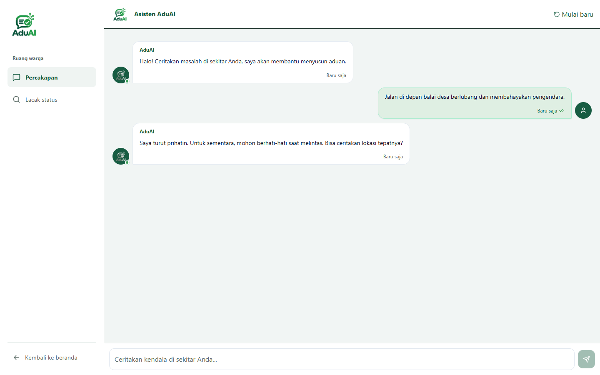

</details>

<details>
<summary><strong>Buat aduan</strong> — <code>/aduan/buat</code></summary>

Route alternatif untuk membuka percakapan aduan.


</details>

<details>
<summary><strong>Lacak laporan</strong> — <code>/laporan/lacak</code></summary>

Pencarian laporan berdasarkan nomor tiket.

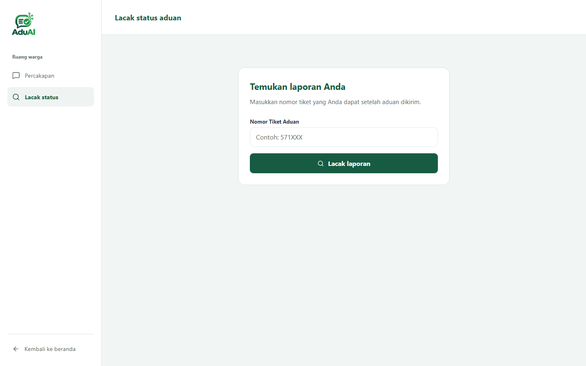

</details>

<details>
<summary><strong>Detail laporan warga</strong> — <code>/laporan/lacak/[ticket]</code></summary>

Ringkasan, status, dan riwayat penanganan laporan.

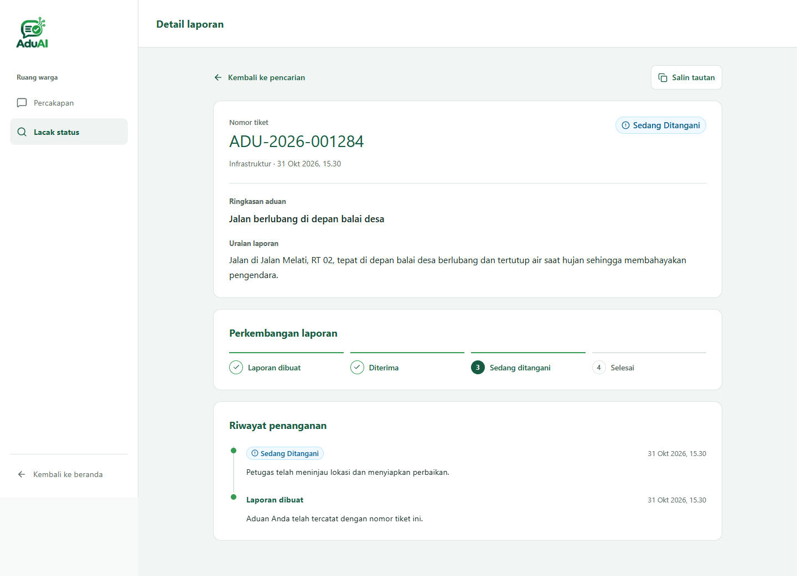

</details>

### Admin

<details>
<summary><strong>Login admin</strong> — <code>/admin/login</code></summary>

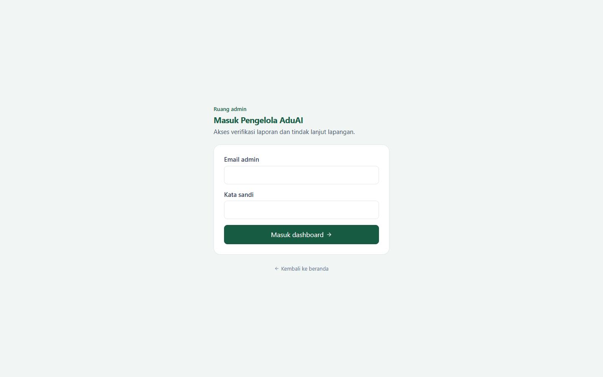

</details>

<details>
<summary><strong>Dashboard</strong> — <code>/admin/dashboard</code></summary>

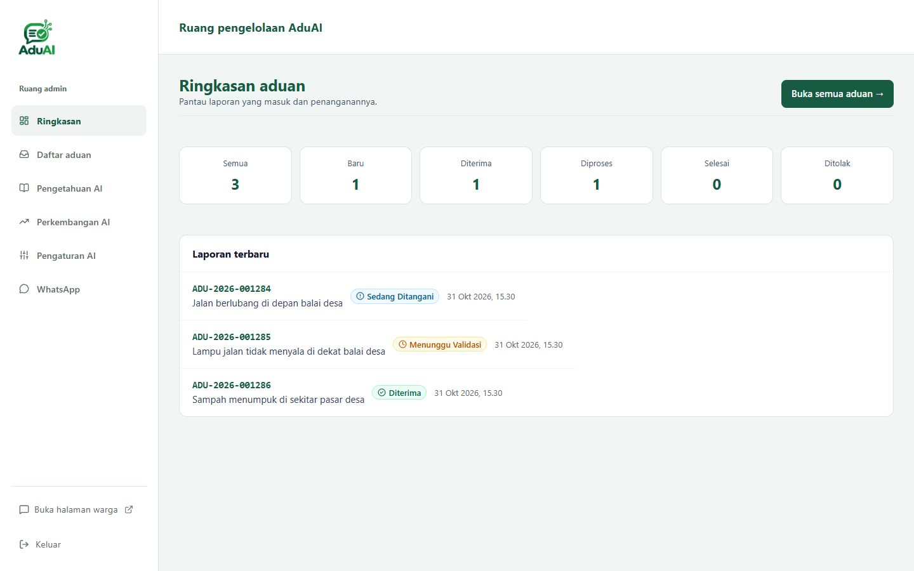

</details>

<details>
<summary><strong>Daftar aduan</strong> — <code>/admin/aduan</code></summary>

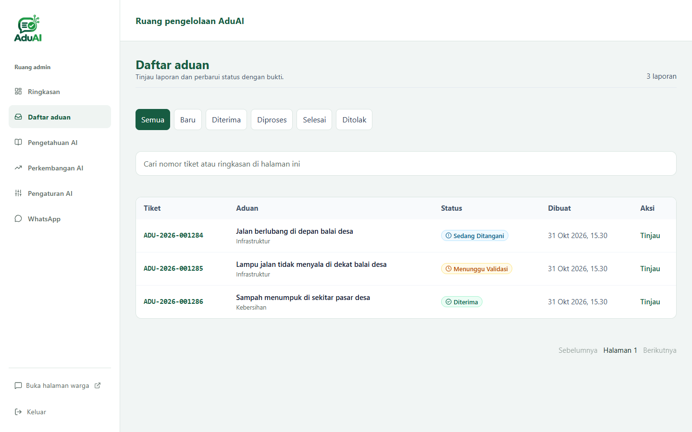

</details>

<details>
<summary><strong>Detail dan pembaruan aduan</strong> — <code>/admin/aduan/[id]</code></summary>

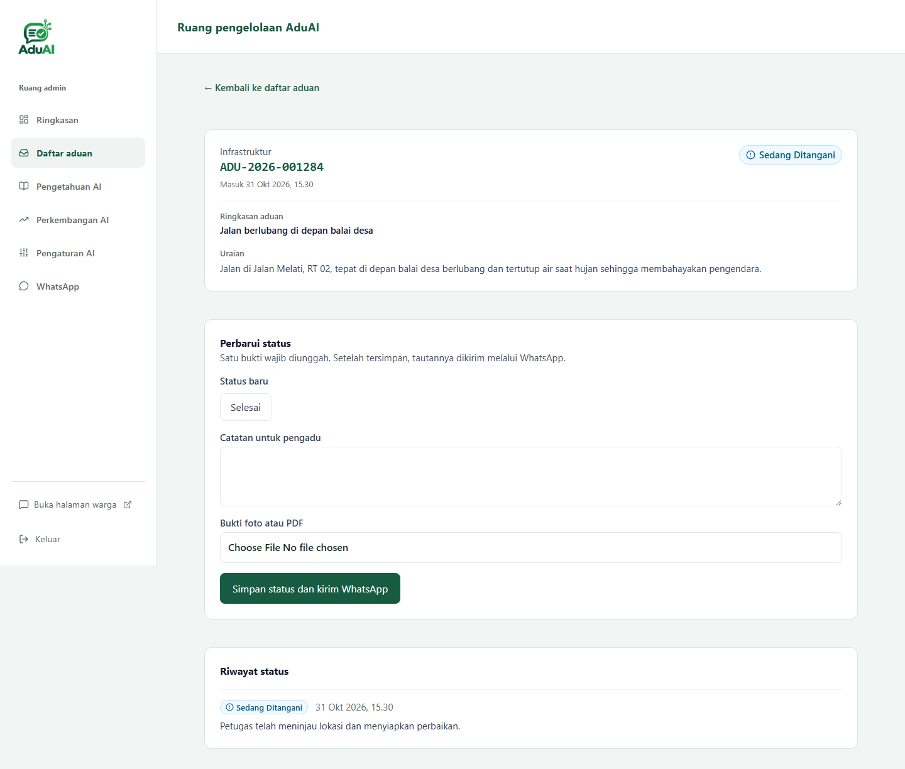

</details>

<details>
<summary><strong>Pengetahuan AI</strong> — <code>/admin/knowledge</code></summary>

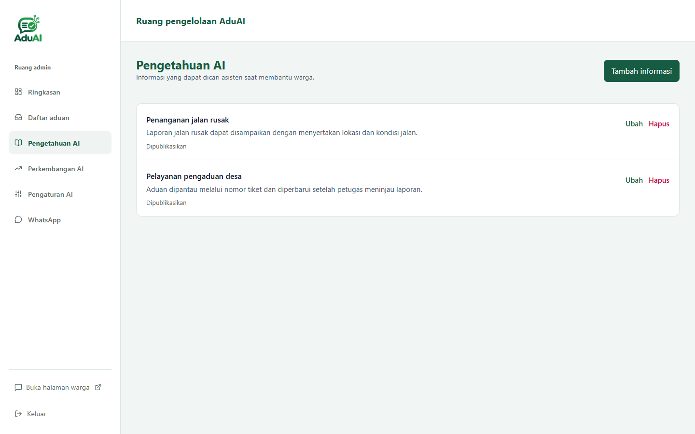

</details>

<details>
<summary><strong>Perkembangan AI</strong> — <code>/admin/pembelajaran</code></summary>

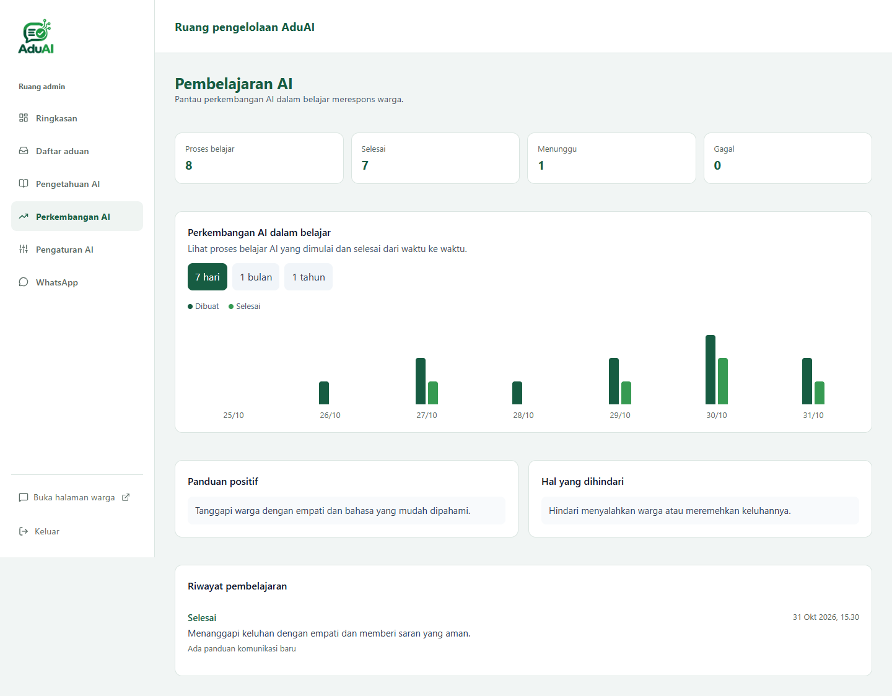

</details>

<details>
<summary><strong>Pengaturan AI</strong> — <code>/admin/pengaturan/ai</code></summary>

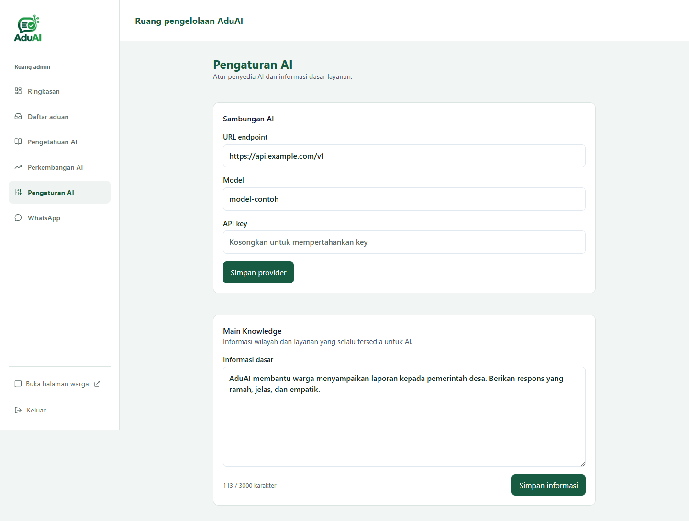

</details>

<details>
<summary><strong>Sambungan WhatsApp</strong> — <code>/admin/pengaturan/whatsapp</code></summary>

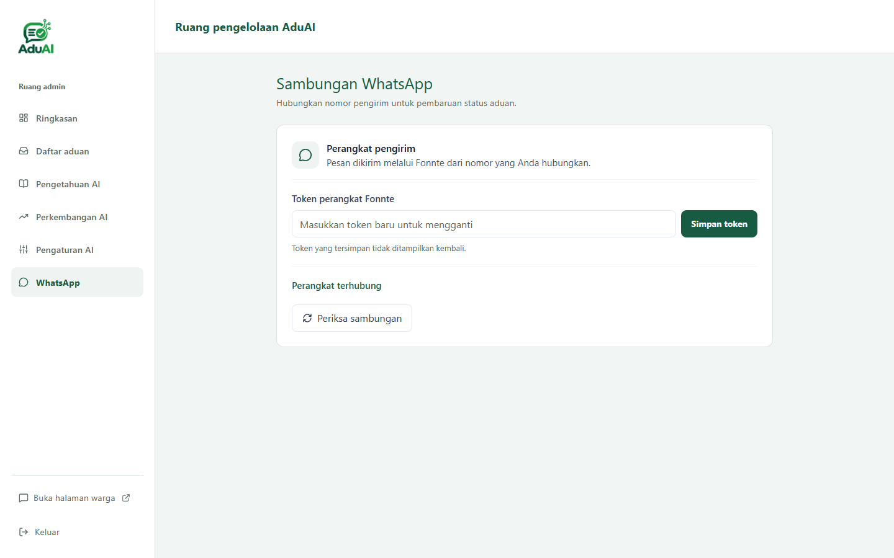

</details>

## Struktur proyek

```text
src/
├── app/          Halaman dan API Route Handlers
├── components/   Komponen antarmuka bersama
├── features/     Fitur chat, aduan, admin, knowledge, dan notifikasi
├── lib/          Utilitas dan integrasi bersama
└── types/        Tipe dan kontrak data
docs/             PRD, panduan, dan screenshot
supabase/         Migrasi database
```

## Dokumentasi tambahan

- [PRD implementasi Next.js](docs/PRD-AduAI-NextJS.md)
- [Panduan AI dan kontrak streaming](docs/ai/README.md)
- [Integrasi backend](docs/ai/07-backend-dimas.md) dan [frontend](docs/ai/08-frontend-cahya.md)
- [Setup WhatsApp dan bukti](docs/setup-whatsapp.md)

Sebagian panduan integrasi dibuat pada tahap pengembangan awal; periksa implementasi terkini ketika mengikuti contoh wiring.

## Tim

- **Mada:** alur AI, provider, dan pembelajaran AI.
- **Dimas:** backend, database, autentikasi, penyimpanan bukti, dan WhatsApp.
- **Cahya:** antarmuka warga dan admin.
